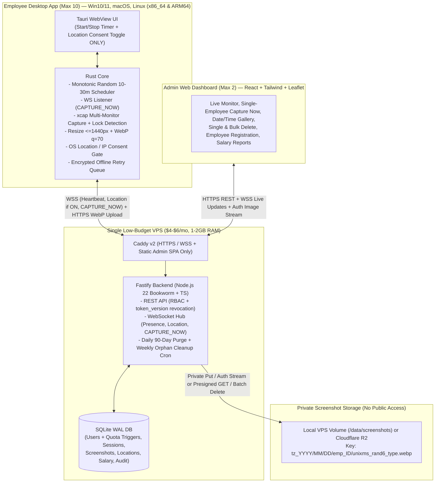

# SM Office Desk — Software Architecture & Low-Budget Technical Blueprint

## 1. Executive Summary & Design Goals
**SM Office Desk** is a lightweight, low-cost employee time-tracking, screenshot verification, optional live location, and salary reporting platform built specifically for small teams (**max 10 active employees, max 2 active admins**).

### Key Non-Functional Targets
- **Server Cost**: **`$0–$6/month`** (single 1–2 GB RAM VPS + **Cloudflare R2 10 GB Free Tier** primary storage, or Oracle Cloud Always Free ARM).
- **Server RAM Footprint**: **~150–250 MB total** across reverse proxy, backend API, WebSocket hub, database, and cron scheduler.
- **90-Day Storage Footprint**: **~2 GB to 4 GB total** for 10 employees using client-side **WebP** compression (~60–110 KB/image), well inside R2's 10 GB Free Tier.
- **Desktop Client Footprint**: **~8–15 MB** installer, **~45–70 MB** RAM on Windows 10/11, macOS, and Linux — **64-bit only (`x86_64` and `ARM64`, no 32-bit `i686`)**.

---

## 2. Low-Budget & Low-Server-Space Tech Stack

| Layer | Selected Technology | Why (Budget & Space Advantage) |
| :--- | :--- | :--- |
| **Desktop Tracker** | **Tauri v2** (Rust + React/TS + Tailwind) | ~8–15 MB installer vs ~150 MB Electron; ~50 MB RAM; native OS screenshot (`xcap`) & WebP (`image`/`webp`) encoding directly on employee PC (0 server CPU used for image processing). |
| **Backend API & WS** | **Node.js 22 LTS (`node:22-bookworm-slim`) + Fastify + TypeScript** | Low RAM (~80–110 MB), unified TypeScript types across API, Admin Web, and Desktop UI; `@fastify/websocket` for instant Admin `CAPTURE_NOW`; `node-cron` for 90-day purge. Debian slim avoids Alpine `musl` native addon issues with `better-sqlite3`. |
| **Database** | **SQLite (WAL mode, `better-sqlite3`) + Drizzle ORM** | **0 MB extra DB server RAM**, atomic DB triggers, single-file storage (~20–50 MB/year), online backups via `sqlite3 .backup` / `VACUUM INTO`, swappable to PostgreSQL later via Drizzle. |
| **Admin Web UI** | **React + Vite + Tailwind CSS + Leaflet** | Compiled to static HTML/JS/CSS served directly by **Caddy** (0 extra Node SSR RAM). Maps use **OpenStreetMap + Leaflet** (**`$0`** API key cost). |
| **Image Storage** | **Cloudflare R2 (Primary, 10 GB Free)** via `StorageDriver` (`@aws-sdk/client-s3`) + `local` dev fallback | **10 GB storage, 1M Class A ops, 10M Class B ops & `$0` egress** free monthly. Keeps VPS disk clean (~2–4 GB/90d stored in R2) and supports an optional R2 90-day lifecycle safety rule alongside DB purge. |
| **Proxy & SSL** | **Caddy v2** | Automatic HTTPS & WSS TLS certificates via Let's Encrypt, ~20 MB RAM, serves static Admin SPA + proxies `/api` & `/ws` (never exposes raw screenshot directories). |
| **CI/CD Builds** | **GitHub Actions** | Automated matrix builds for Windows (`x86_64`, `ARM64`), macOS (`ARM64` + `x86_64`), and Linux (`x86_64`, `ARM64`). |

---

## 3. High-Level System Architecture



---

## 4. Storage, Compression & Anti-Tamper Design

### 4.1 Client-Side WebP & Multi-Monitor Strategy
1. **Multi-Monitor Capture**: Capture all active monitors via `xcap` and stitch/stack them proportionally onto a single canvas scaled to max width **`1440px`** (or **`1600px`** if 2+ ultra-wide monitors so text remains legible), encoded to **WebP (`quality ~70`)**.
   - Prevents employees from hiding non-work activity on a secondary display while still keeping **1 single file (~60–110 KB)** per capture event.
2. **Lock Screen / Sleep Detection**: If OS secure desktop (`Win+L` / UAC), screensaver, or sleep blocks pixel capture, desktop logs/sends a lightweight metadata event (`capture_status = "screen_locked"`) without crashing or uploading blank black images.
3. **Lazy Loading without Duplicate Thumbnails**: At ~80 KB per WebP image and max 10 employees, Admin gallery lazy-loads the single WebP file directly (`loading="lazy"`), avoiding duplicate thumbnail files and cutting storage overhead in half.

### 4.2 90-Day Capacity Math (10 Active Employees)
- **Daily work**: ~8 hours/employee = 480 minutes.
- **Random screenshots** (every 10–30 min, avg ~20 min): ~24 screenshots/day/employee.
- **Admin on-demand screenshots**: ~6 screenshots/day/employee (estimate).
- **Daily volume**: `30 × 10 = 300 images/day` → `300 × 80 KB` ≈ **24 MB/day**.
- **30 days (26 workdays)**: `~7,800 images` ≈ **624 MB/month**.
- **90 days (retention limit)**: `~23,400 images` ≈ **1.87 GB** (even at 2× usage = **~3.7 GB**).
- Steady-state storage stays permanently capped around **~2–4 GB** once daily 90-day auto-purge begins.

### 4.3 Timezone & Anti-Clock-Tampering Rules
- **Monotonic Scheduler**: Desktop random intervals (`600s–1800s`) use Rust `std::time::Instant` (unaffected if employee changes their PC date/time).
- **Authoritative Server Time**: All DB rows (`captured_at`, `started_at`, `expires_at`) use server UTC epoch/ISO-8601.
- **Company Timezone Grouping**: `app_settings.company_timezone` (default `Asia/Dhaka`) controls how storage folder prefixes (`YYYY/MM/DD`) and Admin Date/Hour UI filters group screenshots so midnight/late-night shifts map to the correct local calendar date.
- **Heartbeat Stale Timeout**: Desktop sends a WS/HTTP heartbeat every `60s`. If a PC shuts down or sleeps without clicking Stop, the server automatically marks the session `stopped` after `180s` of silence using `last_heartbeat_at` as `ended_at` (never overcounting idle offline hours in salary calculations).

---

## 5. Security, Privacy & Lifecycle Policies

### 5.1 Zero Employee Control Over Screenshots
- Employee UI exposes **only** `Start Timer` / `Stop Timer` and `Share Live Location (ON/OFF)`.
- Closing the main window (`X`) while timer is active minimizes the app to the System Tray rather than killing tracking.
- **1 Active Session Per Employee**: Bound to a per-install `device_id`. Logging in on a second device while active either rejects with conflict or ends the prior session cleanly.
- If internet drops temporarily, screenshots are encrypted locally (AES-GCM / OS keychain key) and flushed automatically on reconnect, then immediately deleted from employee disk after HTTP `201` server ACK.

### 5.2 Strict Live Location Consent Policy
- **When `Share Live Location = ON`**: Every `60s` heartbeat attempts native OS Location (`Windows.Devices.Geolocation` / macOS `CoreLocation` / Linux `GeoClue2`) and may fall back to IP-based approximate geolocation **only on explicit client opt-in**, tagged honestly as `source: "os_native" | "ip_approx"`. Admin Leaflet map renders the `accuracy_meters` radius circle alongside the source badge.
- **When `Share Live Location = OFF`**: Desktop sends `{ location_enabled: false, lat: null, lng: null }` and **the backend is strictly forbidden from resolving or storing IP-based coordinates**. Admin dashboard shows `"Location disabled by employee"`.

### 5.3 Private Image Serving & Token Revocation
- **Never expose raw screenshot paths publicly.**
  - *LocalDiskDriver*: `GET /api/screenshots/:id/image` verifies Admin JWT + `token_version` before streaming the `.webp` with `Cache-Control: private, max-age=3600`.
  - *R2Driver*: Backend verifies Admin JWT and issues a short-lived (`300s`) presigned GET URL.
- **Immediate Deactivation**: Deactivating an employee (`is_active = 0`) increments `token_version`, immediately terminating their WebSocket and invalidating active tokens while retaining historical salary reports and screenshots until natural 90-day expiry.

### 5.4 Manual/Bulk Delete, 90-Day Purge & Safe Backups
- **Single & Bulk Delete**: Deletes storage object first (`ENOENT`/`NotFound` treated as safe idempotent success), then deletes DB metadata row and writes an entry to `audit_logs`.
- **Daily Purge Cron (`02:00 UTC`)**: Batch-deletes (`500` rows/iteration) expired records and storage files where `expires_at <= UTC_NOW()` for **both `screenshots` and `location_logs`**, followed by `PRAGMA wal_checkpoint(TRUNCATE)`.
- **Weekly Orphan Cleanup**: Scans storage keys older than 24 hours not present in `screenshots` DB and removes leftovers from interrupted writes/deletes.
- **Safe SQLite Backups**: Never copy a live WAL `.db` file with `cp`; use `sqlite3 office.db ".backup /backups/office_$(date).db"` (or `VACUUM INTO`), compress with `gzip`, and sync daily off-site.

---

## 6. Database Schema & Atomic Constraints (SQLite WAL + Drizzle ORM)

SQLite PRAGMAs applied on boot:
`PRAGMA journal_mode = WAL; PRAGMA busy_timeout = 5000; PRAGMA foreign_keys = ON;`

### Tables
- **`app_settings`**: `id` (`1`), `company_name`, `company_timezone` (`Asia/Dhaka`), `currency_code` (`BDT`), `retention_days` (`90`), `updated_at`
- **`users`**: `id`, `name`, `email` (UNIQUE), `password_hash`, `role` (`admin` | `employee`), `designation`, `salary_type` (`monthly` | `hourly`), `base_salary`, `is_active` (`1|0`), `token_version` (`INTEGER DEFAULT 1`), `created_at`, `updated_at`
  - **Atomic SQLite Triggers**:
    - `trg_limit_admins_insert` / `trg_limit_admins_update`: `RAISE(ABORT, 'MAX_ADMINS_EXCEEDED')` when active admins would exceed `2`.
    - `trg_limit_employees_insert` / `trg_limit_employees_update`: `RAISE(ABORT, 'MAX_EMPLOYEES_EXCEEDED')` when active employees would exceed `10`.
    - `trg_prevent_last_admin_disable`: `RAISE(ABORT, 'CANNOT_DISABLE_LAST_ADMIN')` when disabling/deleting the sole remaining active admin.
- **`work_sessions`**: `id`, `employee_id` (FK), `device_id`, `started_at`, `ended_at`, `last_heartbeat_at`, `duration_seconds`, `device_os`, `device_arch`, `app_version`, `status` (`active` | `stopped`)
  - Partial unique index: `CREATE UNIQUE INDEX idx_one_active_session ON work_sessions(employee_id) WHERE status = 'active';`
- **`screenshots`**: `id`, `employee_id` (FK), `session_id` (FK), `capture_type` (`random` | `on_demand`), `capture_status` (`ok` | `screen_locked`), `triggered_by_admin_id` (nullable FK), `storage_key`, `file_size_bytes`, `width`, `height`, `monitor_count`, `captured_at`, `expires_at`, `created_at`
  - Indexes: `(employee_id, captured_at DESC)`, `(expires_at)`
- **`location_logs`**: `id`, `employee_id` (FK), `session_id` (FK), `location_enabled`, `latitude`, `longitude`, `accuracy_meters`, `source` (`os_native` | `ip_approx` | `disabled`), `recorded_at`, `expires_at`
  - Index: `(employee_id, recorded_at DESC)`, `(expires_at)`
- **`salary_reports`**: `id`, `employee_id` (FK), `report_month` (`YYYY-MM`), `period_start`, `period_end`, `total_worked_seconds`, `salary_type_snapshot`, `base_rate_snapshot`, `overtime_or_bonus`, `deductions`, `net_payable`, `currency_code`, `payment_status` (`pending` | `paid`), `paid_at`, `notes`, `created_by_admin_id`, `created_at`, `updated_at`
  - Unique index: `UNIQUE(employee_id, report_month)`
- **`audit_logs`**: `id`, `actor_id`, `action`, `target_type`, `target_id`, `details_json`, `created_at`

### Bootstrap & Recovery CLI Scripts
- `npm run seed:admin` — Interactive/env one-time first admin setup (only runs if `0` admins exist).
- `npm run reset:password -- --email=...` — Safe CLI password reset if an admin loses credentials.

---

## 7. REST API & WebSocket Protocol Contracts

### REST Endpoints
- **Setup & Auth**:
  - `GET /api/health` | `POST /api/auth/login` | `POST /api/auth/refresh` | `POST /api/auth/logout`
- **Admin — Employees (Max 10 Active)**:
  - `GET /api/admin/employees` (returns `activeCount`, `maxEmployees: 10`, list + live session status)
  - `POST /api/admin/employees` | `PATCH /api/admin/employees/:id` (edit profile/salary or toggle `is_active`)
- **Employee Desktop — Sessions & Uploads**:
  - `POST /api/tracker/sessions/start` (`device_id`, `device_os`, `device_arch`, `app_version`)
  - `POST /api/tracker/sessions/heartbeat` (`session_id`, `location_enabled`, optional coordinates)
  - `POST /api/tracker/sessions/stop` (`session_id`)
  - `POST /api/tracker/screenshots` (multipart WebP + `session_id`, `capture_type`, `capture_status`, `request_id`, `monitor_count`)
- **Admin — Live Monitoring & Screenshots**:
  - `POST /api/admin/employees/:id/capture-now` (5s cooldown, dispatches WS command with `request_id` & 15s timeout)
  - `GET /api/admin/screenshots?employeeId=&date=YYYY-MM-DD&hour=HH&type=` (timezone-aware date/time grouping)
  - `GET /api/admin/screenshots/:id/image` (private Admin-only WebP stream / R2 redirect)
  - `DELETE /api/admin/screenshots/:id` | `POST /api/admin/screenshots/bulk-delete`
  - `GET /api/admin/locations/live` (latest consented coordinates per active employee)
- **Admin — Salary Reports & Settings**:
  - `GET /api/admin/salary-reports?month=YYYY-MM` | `POST /api/admin/salary-reports` | `PATCH /api/admin/salary-reports/:id` | `GET /api/admin/salary-reports/export?month=YYYY-MM&format=csv`
  - `GET /api/admin/settings` | `PATCH /api/admin/settings`

### WebSocket Protocol (`wss://<domain>/ws`)
- **Desktop -> Server**: `auth` (`token`, `device_id`), `heartbeat` (`session_id`, `location_enabled`, `coords`), `capture_ack` (`request_id`, `screenshot_id`), `capture_failed` (`request_id`, `reason`)
- **Server -> Desktop**: `CAPTURE_NOW` (`request_id`), `FORCE_STOP` (on admin deactivation or session override)
- **Server -> Admin Dashboard**: `employee_status` (online/offline/locked), `location_update`, `capture_status` (`pending` / `timeout` / `failed`), `screenshot_ready` (instant live preview metadata)

---

## 8. Cross-Platform & CPU Architecture Build Matrix (`x86_64` & `ARM64`)

| OS | Architectures | Package Formats | Critical OS & Packaging Caveats |
| :--- | :--- | :--- | :--- |
| **Windows 10 / 11** | `x86_64` (`x86_64-pc-windows-msvc`), `ARM64` (`aarch64-pc-windows-msvc`) — 64-bit only | `.exe` (`-setup.exe` NSIS + `-portable.exe` standalone), `.msi` (WiX) | `-setup.exe` & `.msi` embed **WebView2 `downloadBootstrapper`** (required on older clean Windows 10 machines); `-portable.exe` requires WebView2 Runtime pre-installed. Uses DXGI/GDI screen capture & WinRT `Geolocator`. |
| **macOS** | `ARM64` Apple Silicon (`aarch64-apple-darwin`) + `x86_64` Intel (`x86_64-apple-darwin`) | Universal `.dmg`, `.app.tar.gz` | `Info.plist` declares Screen Recording & `NSLocationWhenInUseUsageDescription`. **Caveat**: Without an Apple Developer ID (`$99/yr`), Gatekeeper requires one-time `xattr -cr` bypass and macOS TCC resets Screen Recording permission across unsigned updates. |
| **Linux** | `x86_64` (`x86_64-unknown-linux-gnu`), `ARM64` (`aarch64-unknown-linux-gnu`) | `.deb`, `.rpm`, `.AppImage` | Both `x86_64` and `ARM64` build on **Ubuntu 24.04 (`glibc 2.39`, PipeWire >= 1.0)** for Ubuntu 24.04+ and Fedora 40–45+. Pure-Rust `.rpm` bundling via `tauri-bundler`; supports X11 and Wayland (`xdg-desktop-portal` + PipeWire `persist_mode = 2`), `GeoClue2`, and KDE native tray / GNOME `gnome-shell-extension-appindicator` (with automatic window-minimize fallback if no tray is present). |

---

## 9. Agent Tree & Responsibilities

```text
team-leader
├── software-architect      (Architecture, SQLite Triggers/Schema, REST/WS Contracts, Security)
├── ui-ux-agent             (Admin Web + Desktop Tracker Wireframes, Design System, States)
├── coding-agent            (Fastify TS Backend, SQLite WAL, Purge Cron, Salary CRUD, React Admin)
├── desktop-app-agent       (Tauri v2 Rust Core, Monotonic Random/WS Capture, WebP, Location Toggle)
│   └── arch-build-agent    (Win10/11, macOS, Linux; x86_64 & ARM64 Builds, CI/CD, OS Permissions)
└── server-management-agent (VPS Docker/Caddy SSL, Local SSD/R2, 90d Cron Verify, SQLite .backup)
```
